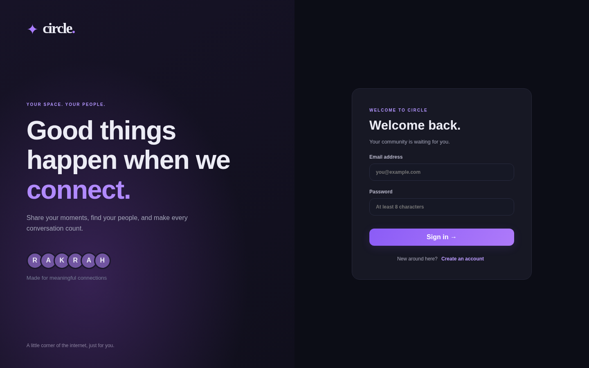
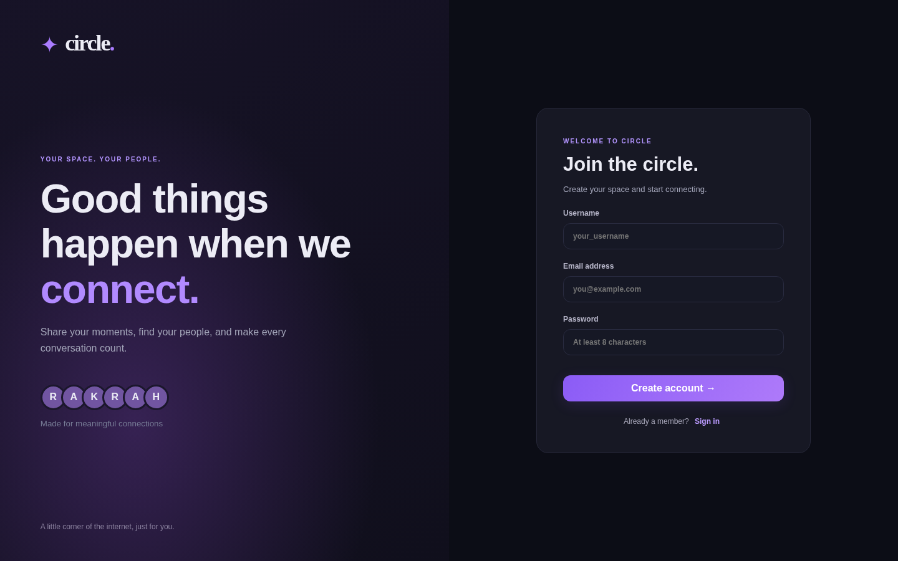
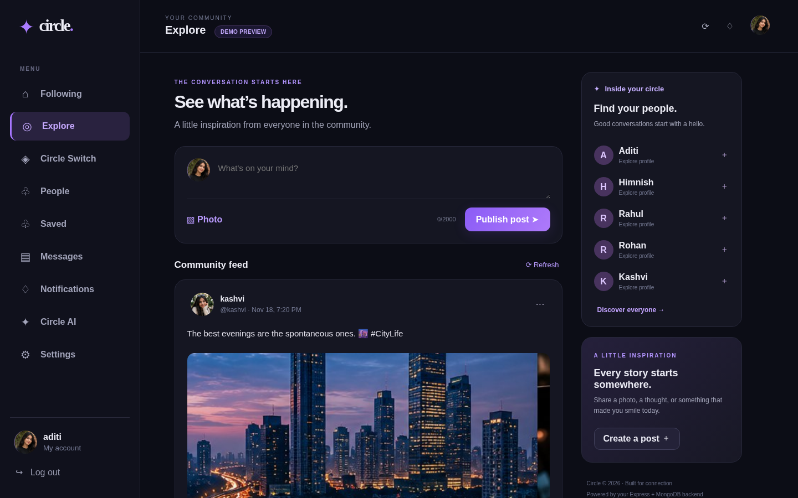
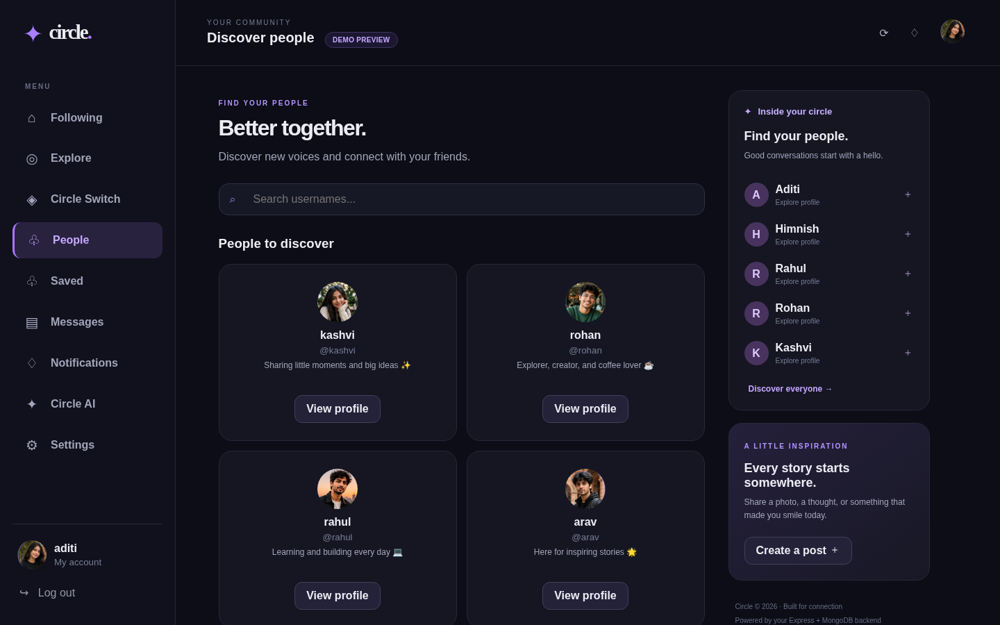
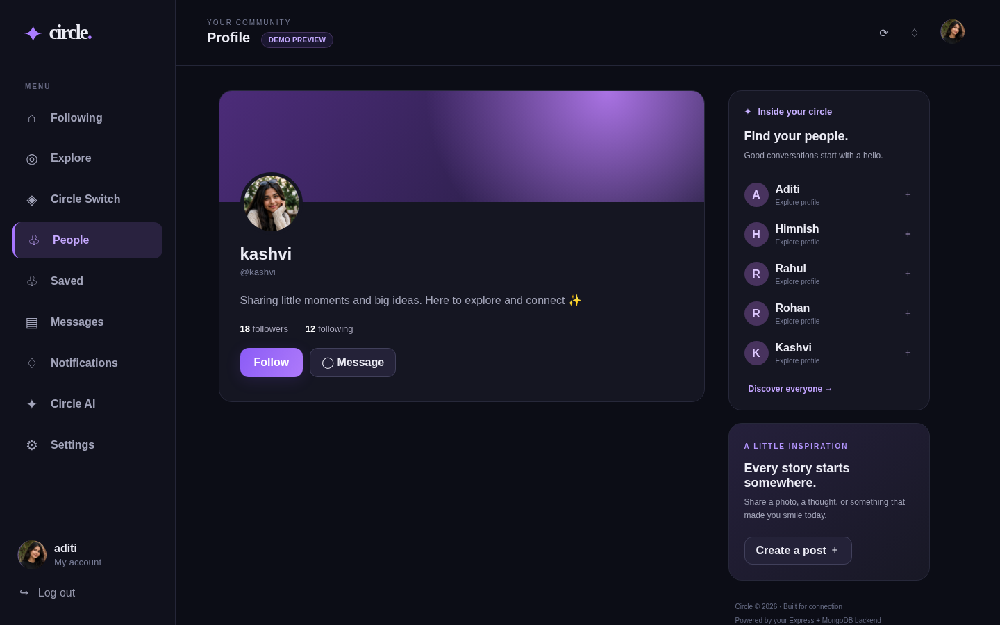
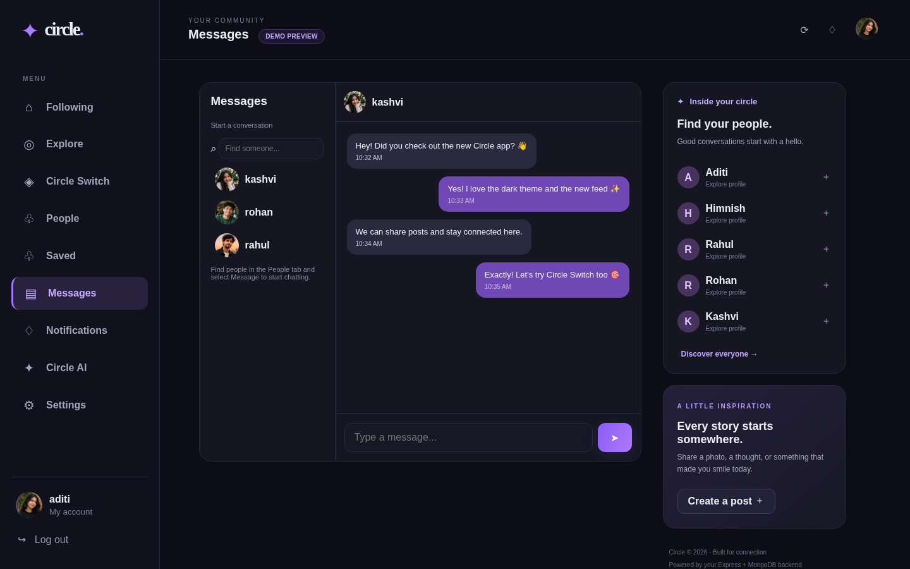
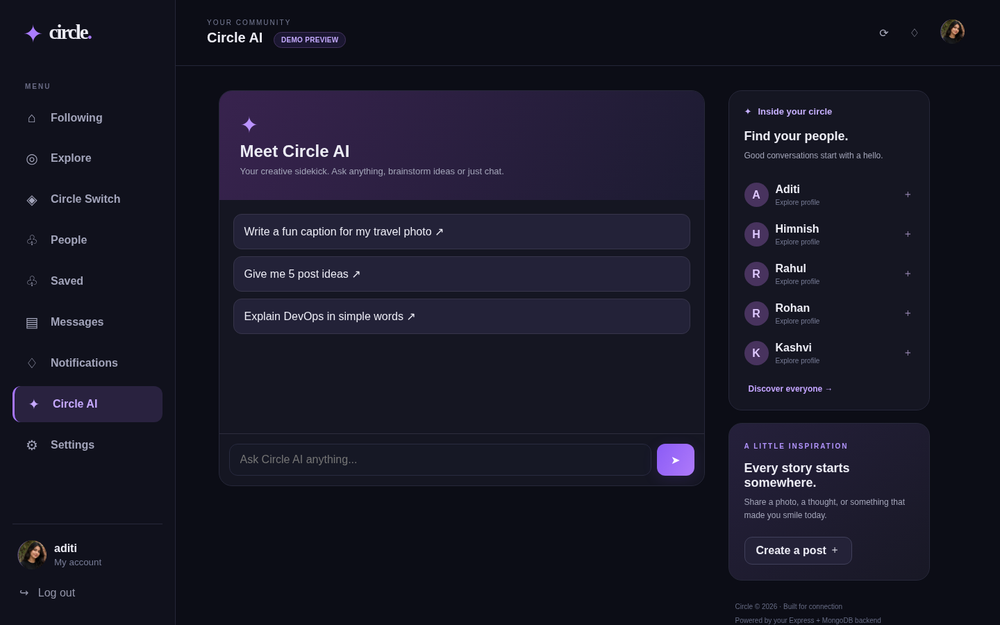
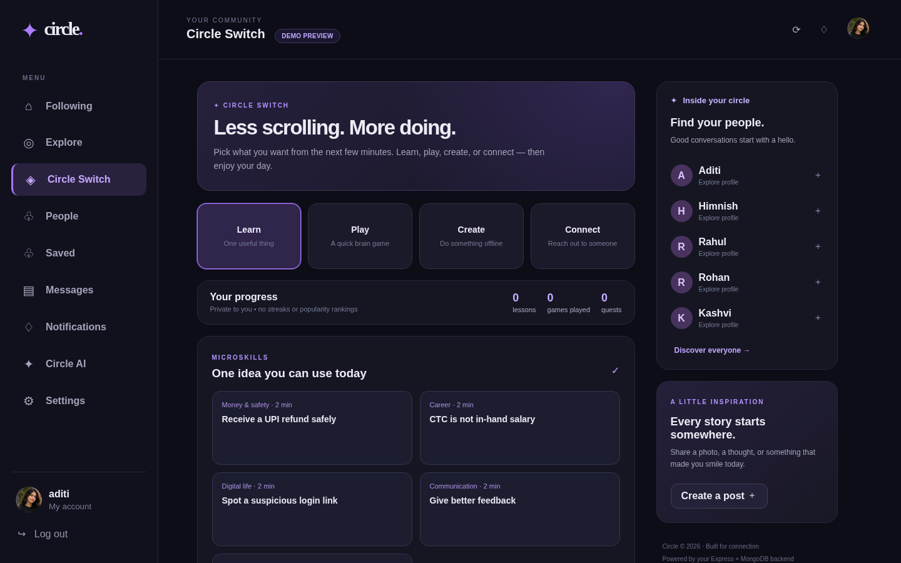

# Circle - Social Media Platform

Circle is a full-stack social media application built using Node.js, Express.js, React, MongoDB, and Socket.IO.

## 📸 Project Screenshots

### 🔐 Login Page

### 📝 Signup Page

### 🏠 Explore Feed

### 🔎 Discover People

### 👤 User Profile

### 💬 Real-Time Messaging

### 🤖 Circle AI Chatbot

### 🎯 Circle Switch

## Tech Stack
- Frontend: React.js
- Backend: Node.js, Express.js
- Database: MongoDB
- Authentication: JWT
- Real-Time Communication: Socket.IO
- Media Storage: Cloudinary
